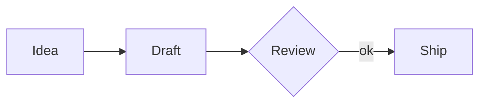

# Making slides with this template

First install the tooling: the [Marp for VS Code](https://marketplace.visualstudio.com/items?itemName=marp-team.marp-vscode) extension, or `npm i -g @marp-team/marp-cli` for the command line.

Every deck starts with this frontmatter:

```markdown
---
marp: true
theme: cpu
paginate: true
html: true
---
```

`html: true` keeps raw HTML alive in every pipeline — the `<script>` loader, `<pre class="mermaid">` blocks, the `.columns` divs; the VS Code extension disables raw HTML unless the file asks for it.

## Where to write

**Inside this repo**: copy `template.md`, rename it, and start editing. The comment at the top of each page explains how that page is written; left in place it becomes a presenter note, and deleting it changes nothing visually. Opening the repo in VS Code gives you a live preview — `.vscode/` already registers the theme. Export with:

```bash
marp slides.md --theme-set themes/cpu.css --allow-local-files -o slides.pdf
```

**Inside your own project**: copy `themes/cpu.css` over (into the project's `themes/`, say). Point the CLI at the theme file when rendering; in VS Code, add one line to the project's `.vscode/settings.json`:

```json
{
  "markdown.marp.themes": ["themes/cpu.css"]
}
```

If your deck references local images (the image pages do), exports must pass `--allow-local-files` or the images won't come through. The VS Code preview doesn't have this restriction.

## Slide types

Pick a layout with `<!-- _class: xxx -->` at the top of the page. Eight of them:

| Class | For | How to write it |
| --- | --- | --- |
| `lead` | Cover | `#` main title (sits in the yellow band), `##` subtitle, two paragraphs (speakers, date), `###`/`####` the two mega words bottom-right — one outlined, one solid |
| `agenda` | Agenda | `##` plus an ordered list; numbers from 01 are generated, first row gets a full highlight |
| no class | Regular content | `##` plus a list; the title brings its own rule and `</>` |
| `roster` | People tables | `##` plus a table; first column is fixed at 350px, just right for name + email + student ID |
| `side` | Side image | `##` plus a few `###` tag blocks with one sentence each, `####` is the mega word bottom-left; the image is a `![height:720px]` line anywhere on the page — see [Images](#images) |
| `yellow` | Section dividers, closing | `##` outlined word, `###` number, `####` headline, last line a credit |
| `activities` | Grouped lists | `##` plus several `###` group tags, each with its own list, packed tighter than a regular page |
| `todo` | Action items | `##` plus `###` tag blocks; blocks spread out automatically |

## Images

Images are ordinary Markdown images sized with Marp's directives — ``, `` (long forms `width:` / `height:`) — never HTML `` tags or scoped styles. Sizing comes from the directive, layout from the theme, and an inline image renders the same in the CLI, in PDF and in the VS Code preview.

**Side image** — on a `_class: side` page, one line anywhere on the page:

```markdown

```

The theme pins the image to the right edge at full slide height and keeps the text clear of it; a landscape image can take `width:` instead. No percentages to tune, nothing can overlap.

**Inline image** — on any content page:

```markdown


*caption line in gray*
```

Alone in its own paragraph (typically below the text) the image is centered horizontally; inside a sentence it just flows with the text. Images carry no frame and are never shrunk — the directive size is exact, and an image that runs past the right edge or the bottom of the slide simply overflows.

**Text beside an image** — a `.columns` block splits the area in two:

```html
<div class="columns">
<div class="column">

- **Left column** — bullets, a sentence or two

</div>
<div class="column">


</div>
</div>
```

The columns share the width equally and their contents are centered vertically; the image can go in either one.

## Diagrams (mermaid)

Keep the loader — the `<script>` block at the top of `template.md`, carried along when you copy the file — and write diagrams as a fenced block:

````markdown

````

The loader pulls mermaid from jsDelivr, renders the diagram in the CPU palette (the colors live in the `initialize()` call — edit them there), and the theme draws it in the same window card as code blocks. The raw `<pre class="mermaid">` form used by the older weekly-session decks works too — the loader picks up either.

Diagrams render in CLI exports (PNG/PDF), in HTML exports, and — the comfortable way while writing — in `marp slides.md --preview --theme-set themes/cpu.css --allow-local-files`, a live-reload server opened in your browser. The VS Code preview strips document scripts (its own security policy; the weekly-session decks solve this the same way — their committed `README_Marp.html` is meant to be opened in a browser), so there the block stays its source card. Offline, point the `src` at a local `mermaid.min.js` and export with `--allow-local-files`.

Skip `![bg]` background images: they render through Marp's background layer, which the VS Code preview and CLI exports draw differently — we have seen the split variant squeeze the text into a narrow column in one and not the other — and on `_class: yellow` pages the photo vanishes outright. Every layout above works without it.

## Writing conventions

- Only the cover uses `#`; every other page starts at `##`, and heading levels don't skip;
- Titles stay on one line; no emoji — visual emphasis is the job of the big numbers and yellow tags;
- `*italics*` render as small gray text for notes and footnotes, not emphasis;
- The agenda holds at most 9 items — beyond that the numbering (a `0` plus the counter) breaks;
- Nested lists indent 3 spaces and code fences declare a language; `.markdownlint.json` is already set up for both;
- Don't drop a global `<style>` into a deck to tweak the theme — that path has bitten us (see the implementation README). Change the theme file itself.

## Migrating an old slides.md

Delete the whole `<style>…</style>` block at the end of the file, add `theme: cpu` to the frontmatter, replace `_class: recruit hf` and `recruit banner` with `_class: side`, put `` on the page (see [Images](#images)), and leave the rest of the content alone.

## Letting Claude write it

The repo ships an agent skill. Install it with the [skills CLI](https://github.com/vercel-labs/skills):

```bash
npx skills add CompPsyUnion/cpu-style-marp-template          # current project
npx skills add CompPsyUnion/cpu-style-marp-template -g       # all your projects
```

It symlinks the skill into every agent it detects — Claude Code, Cursor, Codex and friends. After that, just say "make a CPU deck with the template".
