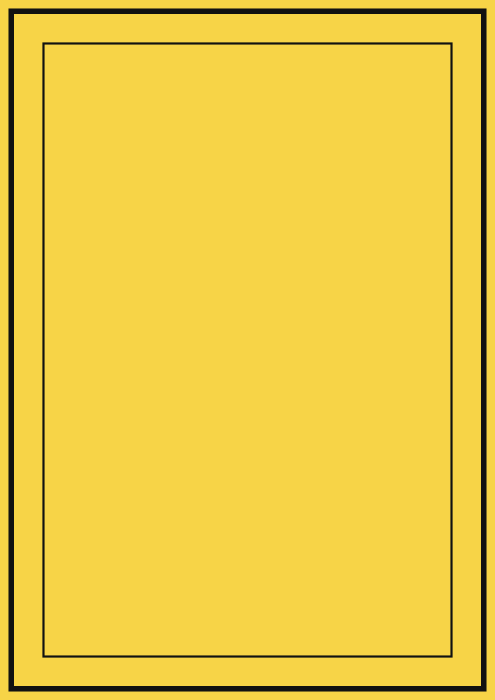

<!--
   CPU Marp template sample · the comment at the top of each page explains how
   that page is written (it doubles as a presenter note).
   Usage guide: docs/usage.md. Keep theme: cpu in the frontmatter.
   Only the cover uses h1; every other page starts at h2. Titles stay on one
   line. No emoji. Images go in with Marp's own sizing directives —
    pinned by the side class,  inline —
   with .columns divs for side-by-side layouts, never other HTML.
-->

<!-- _class: lead -->
<!-- Cover: # main title (inside the yellow band) · ## subtitle · p speakers
     (  per line) + p date · ###/#### mega words bottom-right (outlined /
     solid; either can be dropped) -->

# Presentation Title Here

## Subtitle — occasion, audience, or one-line summary

Speaker One (President) Speaker Two (VP, Tech Group) Speaker Three (VP, Publicity & Ideation Group)

Computer Psycho Union · 1 January 2027

### OUTLINE

#### CPU 2026/27

---

<!-- _class: agenda -->
<!-- Agenda: ordered list of 2–6 items (9 at most; numbers 01–09 are generated,
     first row auto-highlighted); *italics* render as gray secondary text -->

## What we'll cover today

1. First Section *one-line note for the section*
2. Executive Team *the new team — who is who*
3. Activity Plan *key activities for the year*
4. Support & Discussion *where the School can help*

---

<!-- Regular content page (no class): the h2 title gets its rule and </> ·
     lists get yellow square markers · **bold** as the lead-in · nested lists
     are smaller and lighter -->

## 01 · Regular content slide

- **Bold lead-in** — one line of description text
- **Bold lead-in** — one line of description text
   - *nested note renders in gray*
- **Bold lead-in** — one line of description text

---

<!-- _class: roster -->
<!-- Roster page: yellow-headed table with black borders, zebra rows; the first
     column is fixed at 350px (fits name | role | duties) · inside a cell:
     **Name** +   + `email` + *ID* -->

## 02 · Roster table

| Member | Role | Key responsibilities |
| --- | --- | --- |
| **Name One** `email1@nottingham.edu.cn` · *20999999* | President | duty · duty · duty |
| **Name Two** `email2@nottingham.edu.cn` · *20999999* | VP, Tech Group | duty · duty · duty |

- *footnote line in gray italics*

---

<!-- _class: side -->
<!-- Side-image page: the image is a plain  line, put
     anywhere on the page — the theme pins it to the right edge at full
     height and keeps the text clear; a landscape image can use width:
     instead · ### tag blocks distribute vertically on their own · #### is
     the outlined mega word bottom-left -->

## 03 · Side-image slide

### TAG BLOCK ONE

One short sentence under the tag.

### TAG BLOCK TWO

One short sentence under the tag.

#### MEGA

---

<!-- Regular content page with images: ![w:300]/![h:400] size an image
     (width:/height: long forms work the same); standing alone in its
     paragraph it is centered and framed automatically · a .columns block
     with two .column divs puts text and an image side by side -->

## 04 · Inline images

- **Standalone image** — centered, framed, sized by its directive
- **Side by side** — the `.columns` block lays text next to an image

*Caption in gray — sizing comes from the directive, the frame from the theme.*

---

<!-- _class: yellow -->
<!-- Section divider: ## outlined word top-right (all caps) · ### big white
     number · ## big black headline · p credit line at the bottom -->

## SECTION NAME

### 05

#### Section Headline

Credit line — Name One · Name Two · Name Three

---

<!-- _class: activities -->
<!-- Grouped timeline: ### yellow group tags each with a list, packed tighter
     than a regular page; good for around 3 groups -->

## 05 · Grouped timeline

### AUTUMN

- **Activity name** — one-line description
- **Activity name** — one-line description

### SPRING

- **Activity name** — one-line description

### ALL YEAR

- **Activity name** — one-line description

---

<!-- _class: todo -->
<!-- TODO page: ### tag blocks spread out vertically on their own; a list can
     follow the last sentence -->

## TODO

### ITEM ONE

What to arrange, and where.

### ITEM TWO

What to check, and when.

- Room A — purpose
- Room B — purpose

---

<!-- _class: yellow -->
<!-- Closing page: same structure as the section divider -->

## THANK YOU

### Q&A

#### Closing Headline

Closing line — Computer Psycho Union · 1 January 2027
